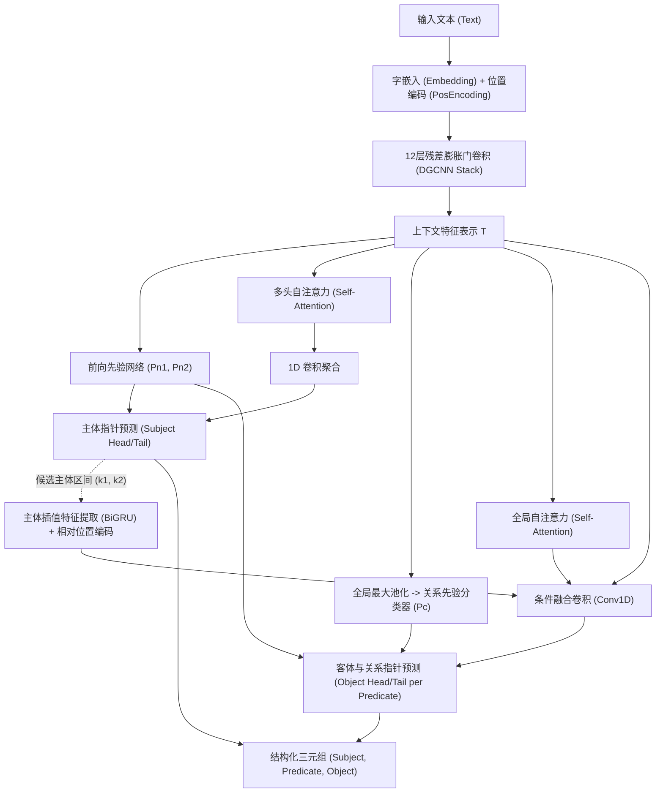

# DGCNN-Information-Extraction (DGCNN-RE 2.0)

[](https://www.python.org/downloads/)
[](https://pytorch.org/)
[](https://opensource.org/licenses/MIT)
[](https://github.com/psf/black)

基于**膨胀门卷积神经网络（Dilated Gated CNN）**与**多头自注意力（Multi-Head Self-Attention）**的实体与关系联合抽取（Joint Entity and Relation Extraction）现代专业重构版。

> 本项目思想源自苏剑林（Jianlin Su）经典工作《基于DGCNN和门位置机制的实体与关系联合抽取》。在此基础上，本项目对整个工程架构进行了系统级现代化重构，全面升级为 **PyTorch 2.x**，解耦算法与工程组件，提供开箱即用的训练、评估、推理与预处理全流程。

---

## 🌟 核心特性与架构升级

对比原始遗留版本（基于 Python 2.7 + TensorFlow 1.5 + 单脚本堆叠），**DGCNN-RE 2.0** 实现了全方位的专业化演进：

| 维度 | 原始版本 (Legacy 1.0) | 现代版本 (Modern 2.0) |
| :--- | :--- | :--- |
| **框架支持** | Python 2.7 + TF 1.5 + Keras 2.2.4（已废弃） | **Python 3.8 ~ 3.13 + PyTorch 2.0+** |
| **设备自适应** | 硬拆分 `complete.py` (CuDNN) 与 `complete_cpu.py` | **自动适配 CUDA / Apple Silicon (MPS) / CPU** |
| **工程解耦** | ~540 行无封装脚本，全局变量与硬编码路径 | **高内聚低耦合包架构 (`dgcnn_re/`)，职责清晰** |
| **参数与配置** | 硬编码在脚本各处 | **结构化 YAML 配置 + 命令行动态覆盖机制** |
| **数据处理** | 拼写错误脚本 (`trainsfor.py`)，缺少防错 | **标准 `Dataset`、`collate_fn`、动态 Padding 与增强** |
| **质量保证** | 无自动化测试，无法持续集成 | **覆盖算子、数据、模型的完整单元测试 (`tests/`)** |
| **推理部署** | 脚本中耦合验证，缺乏对外 API | **高阶 `RelationExtractor` 类与交互式 CLI** |

---

## 📐 模型架构原理

模型采用两阶段分层指针标注机制（Hierarchical Pointer Network），整体流程如下：



1. **特征编码 (DGCNN Encoder)**：
   - 字符 Embedding 融合门控位置向量；
   - 12 层堆叠的膨胀门卷积（Dilation rates: `[1, 2, 5, 1, 2, 5, 1, 2, 5, 1, 1, 1]`），以线性计算复杂度捕获超长上下文跨度依赖。
2. **主体识别 (Subject Pointer)**：
   - 先验网络判定实体边界概率，配合自注意力机制输出主体的首尾指针概率矩阵。
3. **客体与关系抽取 (Object & Relation Pointer)**：
   - 在抽取到的主体区间均匀插值 6 个锚点，经双向 GRU 聚合为主体表征；
   - 引入相对于主体的距离编码与全局关系类别先验；
   - 联合解码客体位置及其归属的关系类别。

---

## 📁 目录结构

```text
DGCNN-information-Extraction/
├── configs/
│   └── default.yaml             # 默认超参数配置文件
├── data/
│   ├── sample_train.json        # 开箱即用的样例数据集
│   ├── sample_schemas.json      # 关系类型定义 (Schema)
│   └── vocab.json               # 字符字典
├── dgcnn_re/                    # 核心算法模块包
│   ├── __init__.py
│   ├── config.py                # 强类型配置系统 (Dataclass + YAML)
│   ├── dataset.py               # 数据集类、字典管理与动态 Collate
│   ├── layers.py                # 膨胀门卷积、多头自注意力、位置编码
│   ├── model.py                 # DGCNN 端到端联合抽取模型
│   ├── loss.py                  # 序列 Masked 二值交叉熵损失
│   ├── metrics.py               # SPO 三元组精准度/召回率/F1 & EMA
│   ├── trainer.py               # 模块化训练引擎 (支持早停与权重平均)
│   └── predictor.py             # 高层推理封装与跨关系解码器
├── tests/                       # 单元测试与冒烟测试
│   ├── test_layers.py
│   ├── test_dataset.py
│   └── test_model.py
├── legacy/                      # 归档的历史遗留旧版代码
├── train.py                     # 训练启动入口 CLI
├── predict.py                   # 推理与交互式测试 CLI
├── preprocess.py                # 数据分析、划分与字典构建 CLI
├── requirements.txt             # 运行依赖清单
├── pyproject.toml               # Python 项目打包元数据
└── README.md                    # 项目文档
```

---

## 🚀 快速上手

### 1. 环境安装

推荐使用 Python 3.8+ 环境：

```bash
git clone https://github.com/MasanoYu/DGCNN-information-Extraction.git
cd DGCNN-information-Extraction

# 安装核心依赖
pip install -r requirements.txt
```

### 2. 运行自动化测试

验证环境与模型算子全部正常：

```bash
python3 -m unittest discover -s tests -v
```

### 3. 模型训练

仓库内置了精简可运行的样本数据 `data/sample_train.json`，无需额外下载即可直接运行验证：

```bash
# 使用默认配置训练（自动检测 GPU/MPS/CPU）
python3 train.py --epochs 15 --batch_size 16

# 或者指定 YAML 配置文件与学习率
python3 train.py --config configs/default.yaml --lr 0.001
```

训练过程中将自动：
- 根据验证集综合 F1 分数保存最优模型权重至 `checkpoints/best_model.pt`；
- 保存最新模型至 `checkpoints/latest_model.pt`；
- 应用指数滑动平均（EMA），提升模型泛化性能。

### 4. 关系抽取与推理

#### 命令行单句抽取：
```bash
python3 predict.py \
  --checkpoint checkpoints/latest_model.pt \
  --text "阿里巴巴集团由马云创立于杭州，旗下的蚂蚁集团控股了网商银行。"
```

输出示例：
```text
Extracted SPO Triplets:
  - Subject: [阿里巴巴集团]  Predicate: [创立者]    Object: [马云]
  - Subject: [阿里巴巴集团]  Predicate: [总部地点]  Object: [杭州]
  - Subject: [阿里巴巴集团]  Predicate: [子公司]    Object: [蚂蚁集团]
  - Subject: [蚂蚁集团]      Predicate: [控股]      Object: [网商银行]
```

#### 交互式 REPL 模式：
```bash
python3 predict.py --checkpoint checkpoints/latest_model.pt
```

#### 批量 JSON 文件推理：
```bash
python3 predict.py \
  --checkpoint checkpoints/latest_model.pt \
  --input_file data/sample_train.json \
  --output_file results.json
```

#### Python API 调用：
```python
from dgcnn_re import RelationExtractor

extractor = RelationExtractor.load_from_checkpoint(
    checkpoint_path="checkpoints/latest_model.pt",
    vocab_path="data/vocab.json",
    schema_path="data/sample_schemas.json",
)

result = extractor.extract("苹果公司的现任首席执行官是蒂姆·库克。")
print(result["triplets"])
# [('苹果公司', '董事长', '蒂姆·库克')]
```

---

## 🛠️ 数据预处理与自定义数据集

如果你有自己的标注数据（格式为包含 `text` 和 `spo_list` 的 JSON 或 JSONL），可以使用内置的清洗与转换工具：

```bash
python3 preprocess.py \
  --input_file my_data.json \
  --output_dir data/my_dataset \
  --val_ratio 0.15 \
  --min_count 2
```

该工具会自动：
1. 校验与标准化三元组格式；
2. 划分训练集与验证集；
3. 生成对应的 `vocab.json` 和 `schemas.json`；
4. 打印数据长度与关系分布统计分析报告。

---

## 📖 引用与鸣谢

本项目模型设计思想来源于苏剑林老师的研究工作，特此致敬：

```bibtex
@misc{jianlin2019bdkgf,
  title={A Hierarchical Relation Extraction Model with Pointer-Tagging Hybrid Structure},
  author={Jianlin Su},
  year={2019},
  publisher={GitHub},
  howpublished={\url{https://github.com/bojone/kg-2019}}
}
```

---

## 📄 开源许可证

本项目遵循 [MIT License](LICENSE)。
